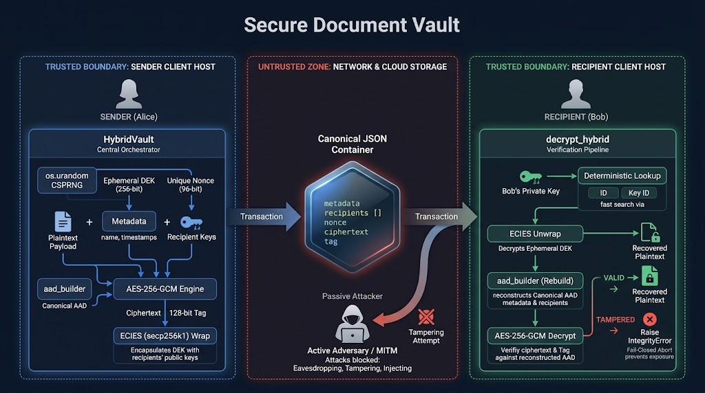

# Secure Document Vault (Cripto-Team-1-Group-2)

**Course:** Cryptography (Term 2027-1) — Facultad de Ingeniería, UNAM  
**Team Members:**
- Jonathan Uriel González Fernández (`jonathanGF`)
- Jesús Eduardo Paz Rosas (`JeedPR`)
- Armando Vázquez Apolonio (`Donapolo`)
- Yukioayax Canek Gabriel Hernández (`YukiGab`)

---

## 1. System Architecture & Trust Boundaries

The system implements a client-side Zero-Trust Document Vault. Cryptographic operations take place strictly inside the local endpoint host before data transmission.



### Trust Boundaries
- **Trusted Boundary (Client Endpoints):** Host CPU, process memory (RAM), OS CSPRNG (`os.urandom`), local private keys, and plaintext buffers. Private keys never leave this perimeter.
- **Untrusted Boundary (Transit & Cloud Storage):** Network transmission channels, cloud hosting providers, external disk persistence, and active adversaries (Man-in-the-Middle).

### Core Components
- **`HybridVault`:** High-level orchestrator coordinating the encryption pipeline, recipient governance, and decryption workflows.
- **`ECIESKeyManager`:** Handles secp256k1 public key normalizations (33-byte compressed format) and ephemeral DEK wrapping/unwrapping.
- **`aad_builder.py`:** Constructs canonical metadata representations and domain-separated Additional Authenticated Data (AAD) byte structures.
- **`Canonical JSON Container`:** Hex-encoded standardized payload housing metadata, recipient tables, nonce, ciphertext, and GHASH tag.

---

## 2. Phase 1: Symmetric Engine (Deliverable D2)

### Cryptographic Primitives
- **Algorithm:** **AES-256-GCM** (Galois/Counter Mode).
- **Line-Rate AEAD:** Hardware-accelerated authenticated encryption leveraging Intel AES-NI and ARM Cryptography extensions.
- **Key Generation:** 256-bit symmetric keys generated via CSPRNG (`AESGCM.generate_key(bit_length=256)`).
- **Nonce Strategy:** Unique 96-bit (12-byte) CSPRNG nonce per file operation (`os.urandom(12)`), preventing IV reuse.

### Metadata Binding & AAD
- **Bound Metadata:** Schema version, UTC timestamp, and original filename.
- **Integrity Enforcement:** Serialized metadata is passed directly as Additional Authenticated Data (AAD) into AES-GCM. Any modification to header fields triggers immediate GHASH verification failure.

---

## 3. Phase 2: Multi-Recipient Hybrid Vault (Deliverable D3)

### Hybrid Encryption Mechanics
- **Bulk Payload Encryption:** A fresh, single-use 256-bit Data Encryption Key (DEK) encrypts the bulk file once via AES-256-GCM, avoiding $O(N)$ storage overhead.
- **Key Encapsulation (ECIES):** The DEK is independently encapsulated for each authorized recipient using ephemeral-static Diffie-Hellman over the **secp256k1** elliptic curve.
- **Deterministic Lookup:** Fast $O(1)$ recipient identification via alphanumeric `id` (max 64 chars) and a canonical SHA-256 fingerprint (`key_id`) computed over the 33-byte compressed public key.

### Canonical Container Schema (D3)
The container adheres to a deterministic, hex-encoded JSON schema:

```json
{
  "metadata": {
    "version": 1,
    "filename": "document.pdf",
    "aead_algorithm": "AES-256-GCM",
    "key_wrap_algorithm": "ECIES-secp256k1",
    "creation_timestamp": "2026-10-25T20:00:00+00:00"
  },
  "recipients": [
    {
      "id": "alice",
      "key_id": "8a3f... (SHA-256 fingerprint)",
      "encrypted_key": "04a1... (hex-encoded ECIES wrapped DEK)"
    },
    {
      "id": "bob",
      "key_id": "3c9b... (SHA-256 fingerprint)",
      "encrypted_key": "04b2... (hex-encoded ECIES wrapped DEK)"
    }
  ],
  "nonce": "12-byte hex string (24 characters)",
  "ciphertext": "variable-length hex string",
  "tag": "16-byte hex string (32 characters)"
}
```

### Fail-Closed Security Policy
- The entire recipient array and metadata are bound into the AES-GCM AAD.
- Any attempt to tamper with ciphertext, modify recipient IDs, alter wrapped keys, reorder entries, or inject unauthorized recipients causes GHASH tag mismatch.
- Decryption aborts immediately, raising an `IntegrityError` without releasing plaintext.

---

## 4. Phase 3: Midterm Verification & Quality Assurance (Deliverable D4)

### Automated Test Suite
The repository includes a comprehensive automated test suite consisting of **84 passing tests and 0 warnings** executed via `pytest`:

- `test_aad_builder.py` (27 tests): Canonical serialization, domain separation, and schema validation.
- `test_hybrid_tampering.py` (9 tests): Tamper resistance across ciphertext bytes, metadata, and recipient tables.
- `test_hybrid_access.py` (5 tests): Unauthorized recipient isolation and access boundary verification.
- `test_hybrid_encryption.py` (4 tests): Multi-recipient key wrapping and duplicate ID rejection.
- `test_decrypt.py` & `test_roundtrip.py` (39 tests): Full end-to-end symmetric and hybrid roundtrip cycles.

### Live Demonstration Matrix (`tests/demo_d4.py`)
The verification script exercises all 4 mandatory evaluation scenarios:
1. **Scenario 1 (Valid Encryption & Decryption):** Alice encrypts a confidential PDF; Alice verifies and restores the plaintext with bit-level fidelity.
2. **Scenario 2 (Multi-Recipient Sharing):** Bob decrypts the exact same container using his independent private key without payload re-encryption.
3. **Scenario 3 (Non-Recipient Rejection):** Carol (unauthorized user with a valid keypair) attempts decryption; access is immediately denied.
4. **Scenario 4 (Tampering & Fail-Closed Enforcement):** Tampering with ciphertext bits and altering recipient headers triggers GHASH mismatch and raises `IntegrityError`.

---
## 5. Phase 4: Digital Signatures & Authentication (Deliverable D5)

### Digital Signatures

D5 adds digital signatures to the existing hybrid encryption system to verify the sender's identity and detect modifications to encrypted documents.

- **Algorithm:** Ed25519.
- **Signature Module:** `signature_manager.py`.
- **Container Structure:** Updated to include `signature` and `signer_id`.
- **Signed Data:** Metadata, recipients, nonce, ciphertext, authentication tag, and signer ID.
- **Signer Identification:** SHA-256 fingerprint of the Ed25519 public key.

### Encryption & Verification Workflow

The `hybrid_vault.py` module now integrates digital signatures into the encryption and decryption processes.

**Encryption:**

Encrypt → Add Metadata → Sign → Store

**Decryption:**

Read Container → Validate → Verify Signature → Decrypt

The system follows a **Fail-Closed** approach. If the signature is invalid, missing, or belongs to an untrusted signer, the document is rejected before decryption.

Trusted public keys are provided through the `trusted_signers` registry, independently of the encrypted container.

### Testing

The team added unit tests and integration tests to verify the D5 requirements.

The five required scenarios were tested:

- **A:** Valid signature accepted.
- **B:** Modified ciphertext rejected.
- **C:** Modified metadata rejected.
- **D:** Incorrect public key rejected.
- **E:** Missing signature rejected.

Additional tests cover JSON serialization, invalid signatures, and Fail-Closed behavior.

**Final test results:**

`python -m pytest -q`

**135 passed, 0 failed.**

### Current Limitations

The system requires trusted public keys to be supplied externally. Persistent key management, revocation, and replay protection are not implemented in this deliverable.

## 5. Setup & Execution Instructions

### Prerequisites
- Python 3.10+
- Virtual environment tool (`venv`)

### Installation
```bash
# Clone repository
git clone https://github.com/<your-repo>/cripto-vault.git
cd cripto-vault

# Create and activate virtual environment
python -m venv venv
source venv/bin/activate  # On Windows: venv\Scripts\activate

# Install dependencies
pip install -r requirements.txt
```

### Running the Test Suite
```bash
pytest -v
```

### Running the D4 Live Demo
```bash
python tests/demo_d4.py
```

