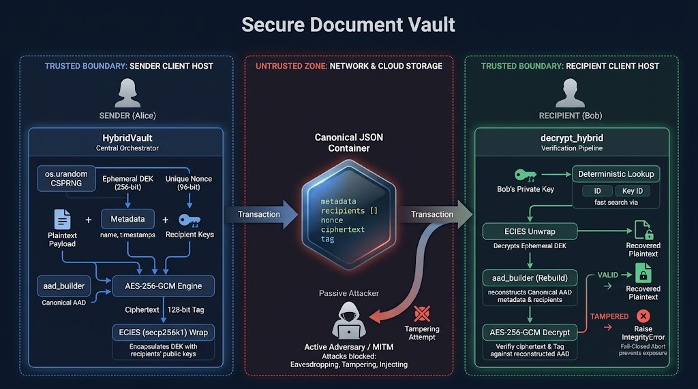

# Secure Document Vault (Cripto-Team-1-Group-2)

**Course:** Cryptography (Term 2027-1) — Facultad de Ingeniería, UNAM  
**Team Members:**
- Jonathan Uriel González Fernández (`jonathanGF`)
- Jesús Eduardo Paz Rosas (`JeedPR`)
- Armando Vázquez Apolonio (`Donapolo`)
- Yukioayax Canek Gabriel Hernández (`YukiGab`)

---

## 1. System Architecture & Trust Boundaries

The system implements a client-side Secure Document Vault with a zero-trust approach to transit and storage. File encryption, signing, and private-key operations run on the local endpoint before a protected container is shared. The endpoint itself is a trusted assumption, not a defense against a compromised host.



### Trust Boundaries
- **Trusted Boundary (Client Endpoints):** Host CPU, process memory (RAM), OS CSPRNG (`os.urandom`), locally decrypted private keys, plaintext buffers, and locally supplied passwords. **Plaintext private keys must remain inside this boundary**; encrypted keystores and backups can be stored separately.
- **Untrusted Boundary (Transit & Cloud Storage):** Network transmission channels, cloud hosting providers, external disk persistence, and active adversaries (Man-in-the-Middle).

### Core Components
- **`HybridVault`:** High-level orchestrator coordinating the encryption pipeline, recipient governance, and decryption workflows.
- **`ECIESKeyManager`:** Manages secp256k1 recipient keys and ECIES data-encryption-key (DEK) wrapping/unwrapping; D6 also integrates password-protected keystore access.
- **`aad_builder.py`:** Constructs canonical metadata, domain-separated Additional Authenticated Data (AAD), and the canonical signing payload.
- **`signature_manager.py`:** Manages Ed25519 key generation, digital signing, and signature verification.
- **`Canonical JSON Container`:** Standardized hex-encoded container with metadata, recipients, nonce, ciphertext, authentication tag, `signature`, and `signer_id`.
- **`secure_keystore.py`:** Password-based private-key protection and authenticated JSON storage (D6).
- **`key_backup.py`:** Encrypted keystore backup, verification, and restoration (D6).
- **`key_lifecycle.py`:** Authenticated key registry, rotation, revocation, expiry, and policy-aware encryption/decryption (D6).

---

## 2. Phase 1: Symmetric Engine (Deliverable D2)

### Cryptographic Primitives
- **Algorithm:** **AES-256-GCM** (Galois/Counter Mode).
- **Line-Rate AEAD:** Hardware-accelerated authenticated encryption leveraging Intel AES-NI and ARM Cryptography extensions.
- **Key Generation:** 256-bit symmetric keys generated via CSPRNG (`AESGCM.generate_key(bit_length=256)`).
- **Nonce Strategy:** Unique 96-bit (12-byte) CSPRNG nonce per file operation (`os.urandom(12)`), preventing IV reuse.

### Metadata Binding & AAD
- **Bound Metadata:** Schema version, UTC timestamp, and original filename.
- **Integrity Enforcement:** Serialized metadata is passed directly as Additional Authenticated Data (AAD) into AES-GCM. Any modification to header fields triggers immediate GHASH verification failure.

---

## 3. Phase 2: Multi-Recipient Hybrid Vault (Deliverable D3)

### Hybrid Encryption Mechanics
- **Bulk Payload Encryption:** A fresh, single-use 256-bit Data Encryption Key (DEK) encrypts the bulk file once via AES-256-GCM, avoiding $O(N)$ storage overhead.
- **Key Encapsulation (ECIES):** The DEK is independently encapsulated for each authorized recipient using ephemeral-static Diffie-Hellman over the **secp256k1** elliptic curve.
- **Deterministic Lookup:** Fast $O(1)$ recipient identification via alphanumeric `id` (max 64 chars) and a canonical SHA-256 fingerprint (`key_id`) computed over the 33-byte compressed public key.

### Canonical Container Schema (D3)
The container adheres to a deterministic, hex-encoded JSON schema:

```json
{
  "metadata": {
    "version": 1,
    "filename": "document.pdf",
    "aead_algorithm": "AES-256-GCM",
    "key_wrap_algorithm": "ECIES-secp256k1",
    "creation_timestamp": "2026-10-25T20:00:00+00:00"
  },
  "recipients": [
    {
      "id": "alice",
      "key_id": "8a3f... (SHA-256 fingerprint)",
      "encrypted_key": "04a1... (hex-encoded ECIES wrapped DEK)"
    },
    {
      "id": "bob",
      "key_id": "3c9b... (SHA-256 fingerprint)",
      "encrypted_key": "04b2... (hex-encoded ECIES wrapped DEK)"
    }
  ],
  "nonce": "12-byte hex string (24 characters)",
  "ciphertext": "variable-length hex string",
  "tag": "16-byte hex string (32 characters)"
}
```

### Fail-Closed Security Policy
- The entire recipient array and metadata are bound into the AES-GCM AAD.
- Any attempt to tamper with ciphertext, modify recipient IDs, alter wrapped keys, reorder entries, or inject unauthorized recipients causes GHASH tag mismatch.
- Decryption aborts immediately, raising an `IntegrityError` without releasing plaintext.

---

## 4. Phase 3: Midterm Verification & Quality Assurance (Deliverable D4)

### Automated Test Suite
At the D4 milestone, the automated suite reported **84 passing tests**. The original D4 coverage included:

- `test_aad_builder.py` (27 tests): Canonical serialization, domain separation, and schema validation.
- `test_hybrid_tampering.py` (9 tests): Tamper resistance across ciphertext bytes, metadata, and recipient tables.
- `test_hybrid_access.py` (5 tests): Unauthorized recipient isolation and access boundary verification.
- `test_hybrid_encryption.py` (4 tests): Multi-recipient key wrapping and duplicate ID rejection.
- `test_decrypt.py` & `test_roundtrip.py` (39 tests): Full end-to-end symmetric and hybrid roundtrip cycles.

### Live Demonstration Matrix (`tests/demo_d4.py`)
The verification script exercises all 4 mandatory evaluation scenarios:
1. **Scenario 1 (Valid Encryption & Decryption):** Alice encrypts a confidential PDF; Alice verifies and restores the plaintext with bit-level fidelity.
2. **Scenario 2 (Multi-Recipient Sharing):** Bob decrypts the exact same container using his independent private key without payload re-encryption.
3. **Scenario 3 (Non-Recipient Rejection):** Carol (unauthorized user with a valid keypair) attempts decryption; access is immediately denied.
4. **Scenario 4 (Tampering & Fail-Closed Enforcement):** Tampering with ciphertext bits and altering recipient headers triggers GHASH mismatch and raises `IntegrityError`.

---

## 5. Phase 4: Digital Signatures & Authentication (Deliverable D5)

### Digital Signatures

D5 adds digital signatures to the existing hybrid encryption system to verify the sender's identity and detect modifications to encrypted documents.

- **Algorithm:** Ed25519.
- **Signature Module:** `signature_manager.py`.
- **Container Structure:** Updated to include `signature` and `signer_id`.
- **Signed Data:** Metadata, recipients, nonce, ciphertext, authentication tag, and signer ID.
- **Signer Identification:** SHA-256 fingerprint of the Ed25519 public key.
- **Signing Process:** The canonical payload is hashed with SHA-256 and the digest is signed using Ed25519, which also uses SHA-512 internally.

### Encryption & Verification Workflow

The `hybrid_vault.py` module now integrates digital signatures into the encryption and decryption processes.

**Encryption:**

Encrypt → Add Metadata → Sign → Store

**Decryption:**

Read Container → Validate → Verify Signature → Decrypt

The system follows a **Fail-Closed** approach. If the signature is invalid, missing, or belongs to an untrusted signer, the document is rejected before decryption.

Trusted public keys are provided through the `trusted_signers` registry, independently of the encrypted container.

### Testing

The team added unit tests and integration tests to verify the D5 requirements.

The five required scenarios were tested:

- **A:** Valid signature accepted.
- **B:** Modified ciphertext rejected.
- **C:** Modified metadata rejected.
- **D:** Incorrect public key rejected.
- **E:** Missing signature rejected.

Additional tests cover JSON serialization, invalid signatures, and Fail-Closed behavior.

**Historical D5 test result:** `python -m pytest -q` → **135 passed, 0 failed** at that milestone. The current integrated project result is recorded in the D6 testing section below.

### D5 Scope at the Time

At the D5 milestone, trusted signer keys had to be supplied externally, and persistent key management and revocation were not yet included. D6 adds a password-protected keystore and an authenticated lifecycle registry. **Replay protection and authenticated rollback prevention are still outside the current implementation**.

---

## 6. Phase 5: Secure Key Management (Deliverable D6)

D6 protects private keys at rest, enables encrypted backup and recovery, and introduces explicit lifecycle rules for encryption and signing keys. It builds on D3 hybrid encryption and D5 sender authentication rather than replacing them.

### 6.1 Password-Protected Private Keys

**Module:** [`src/crypto/secure_keystore.py`](src/crypto/secure_keystore.py)

- **Key-encryption key (KEK):** Derived from a user password with **Scrypt** and a fresh **16-byte random salt**.
- **Default Scrypt parameters:** `N=65536` (`2^16`), `r=8`, `p=1`, `dklen=32` bytes. Parameters are stored alongside the encrypted key so the KEK can be re-derived on recovery.
- **Encryption:** **AES-256-GCM**, using a fresh **12-byte nonce**. The stored `encrypted_private_key` value contains the encrypted 32-byte private key **and the 16-byte GCM authentication tag**, encoded in hexadecimal.
- **Authenticated metadata:** Keystore version, `key_id`, algorithm, usage, creation timestamp, KDF parameters, and salt are bound as AES-GCM Additional Authenticated Data (AAD).
- **Supported algorithms and purposes:** `secp256k1` for decryption and `Ed25519` for signing. A mismatched key purpose or `key_id` is rejected.
- **Identity:** The `key_id` is a SHA-256 fingerprint derived from the corresponding public key; the key recovered from a keystore is checked against this identity.
- **KDF safety limits:** Scrypt parameters are validated before derivation (including a **256 MiB estimated memory ceiling**) to reject resource-exhaustion settings in manipulated keystores.
- **Password policy:** Passwords are not written to the keystore. Private keys are decrypted only when necessary and are not cached indefinitely by these modules. Python cannot guarantee complete erasure of secret material from RAM.

#### Keystore JSON format

The following is an **illustrative schema**, not a usable key or real credential:

```json
{
  "metadata": {
    "version": "1.0",
    "key_id": "<64-character lowercase SHA-256 fingerprint>",
    "algorithm": "secp256k1",
    "usage": "decryption",
    "created_at": "<UTC timestamp>",
    "user_id": "alice"
  },
  "kdf_parameters": {
    "algorithm": "scrypt",
    "n": 65536,
    "r": 8,
    "p": 1,
    "dklen": 32
  },
  "salt": "<16 random bytes, hex-encoded>",
  "nonce": "<12 random bytes, hex-encoded>",
  "encrypted_private_key": "<ciphertext plus GCM tag, hex-encoded>"
}
```

`user_id` is optional; the other fields shown are required. For Ed25519 keys, use `"algorithm": "Ed25519"` and `"usage": "signing"`.

The public API includes `create_keystore`, `save_keystore`, `load_keystore`, and `decrypt_private_key`. The integration in [`src/crypto/key_manager.py`](src/crypto/key_manager.py) and `decrypt_hybrid_with_keystore` in [`src/crypto/hybrid_vault.py`](src/crypto/hybrid_vault.py) uses this protected storage. During decryption, the container's **sender signature is verified before a password prompt**, then the recipient's `key_id` is compared with the keystore, and only then is the private key unlocked.

### 6.2 Encrypted Backup and Recovery

**Module:** [`src/crypto/key_backup.py`](src/crypto/key_backup.py)

- `create_backup(keystore_path, backup_path)` copies an **already encrypted** keystore into a versioned JSON backup envelope.
- `verify_backup(backup_path)` checks structure, key identity, and the SHA-256 checksum.
- `restore_backup(backup_path, target_path)` restores the same encrypted keystore; its password and `key_id` remain unchanged.
- Backup and restore operations do **not** decrypt the private key. The checksum is for accidental corruption detection, **not cryptographic authenticity**: anyone able to rewrite the backup can also recompute the checksum. AES-GCM authentication is verified when the restored private key is unlocked.
- Backup and restoration refuse to overwrite existing files unless explicitly requested; temporary writes and restrictive permissions are attempted where supported.

A backup should be stored separately from its primary keystore, with access controls and a strong password. Test restoration periodically. Backups remain sensitive because they permit offline password guessing.

### 6.3 Key Lifecycle and Policy-Aware Access

**Module:** [`src/crypto/key_lifecycle.py`](src/crypto/key_lifecycle.py)

The lifecycle registry tracks each public key and its `key_id`, user, algorithm, status, creation date, expiration date, and keystore filename. **It does not store plaintext private keys.** Supported key statuses are `active`, `retired`, and `revoked`; expiration is computed from `expires_at`.

| Key status | New encryption / signing | Decryption / verification of old material |
|---|---|---|
| **Active, not expired** | Allowed for the matching purpose | Allowed |
| **Retired** | Denied | Allowed |
| **Expired** | Denied | Allowed |
| **Revoked** | Denied | Denied; owner decryption is possible only through explicit `recovery=True` |

The lifecycle API supports:

- **Generation:** `generate_key` creates a new keypair, stores its private key in an encrypted keystore, and records its public identity (default validity: 365 days).
- **Rotation:** `rotate_key` retires the previous active key and creates a replacement. Existing documents can still be opened with the old retired key.
- **Revocation:** `revoke_key` marks a key as compromised or invalid; `handle_compromise` can create a replacement and returns manual follow-up actions, including re-encrypting affected documents and notifying other users.
- **Access policies:** `check_key_usable` enforces valid algorithm/purpose combinations and status restrictions; `build_trusted_signers` excludes revoked Ed25519 signers.

#### Registry integrity

The registry file is authenticated using **HMAC-SHA256**, with an HMAC key derived from a **separate `registry_password`** using Scrypt. `load_registry` rejects a modified registry or incorrect password before its data can be trusted. Keep the registry password separate from ordinary keystore files and never commit it.

**Important integration rule:** Use `encrypt_with_registry` and `decrypt_with_registry` as the policy-aware entry points. Calling the lower-level functions in `hybrid_vault.py` directly **does not automatically enforce registry status policies**. Reload the authenticated registry before security-sensitive operations to avoid relying on outdated revocation state.

**Recovery policy:** `recovery=True` deliberately permits the owner to decrypt an old document with a revoked decryption key in order to migrate its contents to a replacement. It is **not** permission to use the revoked key for new encryption; it requires access to the valid private key and its password.

### 6.4 D1 Threat Model Alignment and Security Boundaries

| Threat / scenario | Implemented protection | Remaining limitation |
|---|---|---|
| **Attacker steals the keystore or encrypted backup** | Private key is encrypted with a password-derived AES-256-GCM key; a stolen file alone does not unlock the key. | Offline password guessing remains possible; weak passwords may be broken. |
| **Attacker modifies a keystore** | AES-GCM tag authenticates encrypted key and bound metadata; invalid modifications fail on unlock. | Compromise of the password or endpoint still threatens the key. |
| **Attacker modifies the lifecycle registry** | HMAC verification detects unauthorized edits, such as changing a key from `revoked` to `active`. | A valid older registry can be replayed (rollback), and possession of `registry_password` permits authenticated changes. |
| **Attacker compromises the endpoint** | Data at rest remains encrypted when keys are locked. | Malware that observes passwords, memory, or decrypted keys during legitimate use is outside this protection. |
| **A key is compromised** | Registry revocation stops policy-aware new use and can trigger rotation and recovery procedures. | Revocation cannot erase a stolen private key or prevent offline decryption of already copied containers; affected data may need re-encryption. |

Security assumptions: the endpoint, OS random number generator, required libraries, and out-of-band trusted public-key distribution must be trustworthy during operations. This prototype does not provide a hardware-backed keystore, centralized identity administration, guaranteed memory erasure, or robust anti-rollback/replay protection.

### 6.5 D6 Required Scenarios and Integration Demo

**Acceptance tests:** [`tests/test_d6_integration.py`](tests/test_d6_integration.py)  
**Live demonstration:** [`tests/demo_d6.py`](tests/demo_d6.py)

The automated D6 acceptance scenarios cover:

1. **Correct password:** encrypted private key can be recovered by the authorized user.
2. **Incorrect password:** key access is denied.
3. **Modified keystore:** authentication or schema validation fails.
4. **Backup and restore:** the original key identity and ability to decrypt are preserved.
5. **Stolen keystore alone:** the serialized encrypted file does not reveal the plaintext key or password, and an incorrect password is rejected. This demonstrates the implemented controls, not a proof against brute-force attacks on weak passwords.

The integration tests and demo additionally exercise **D3 multi-recipient hybrid encryption, D5 signatures, D6 restored-key decryption, tamper rejection before password entry, revoked-key denial, explicit recovery mode, and HMAC-protected registry integrity**.

**Verified team test results (Windows, integrated `Iterartion1`, November 15, 2026):**

```text
python -m pytest -v
182 passed in 10.69s

python tests/demo_d6.py
RESULT: 5/5 mandatory D6 scenarios PASS
RESULT: Real D3 + D5 + D6 integration PASS
```

These results document the team's observed execution on the integrated branch; times and test counts may change as the project evolves. The full hybrid demo reports `NOT VERIFIED` instead of `PASS` when its `eciespy`/`coincurve` dependencies are missing.

For implementation details, see [`Documentacion/D6_Backup_Lifecycle.md`](Documentacion/D6_Backup_Lifecycle.md), alongside the [D5 design notes](Documentacion/READMED5.md) and the earlier documents under `Documentacion/`.

---

## 7. Setup & Execution Instructions

### Prerequisites

- **Python 3.10+**
- `venv` (included with most Python installations)
- Dependencies in [`requirements.txt`](requirements.txt): `cryptography`, `eciespy`, `coincurve`, and `pytest`

### Installation

**1. Clone the repository**

```bash
git clone https://github.com/Donapolo/Cripto-Team-1-Group-2.git
cd Cripto-Team-1-Group-2
```

To work with the current integrated deliverable branch:

```bash
git switch Iterartion1
```

**2. Create a virtual environment**

```bash
python -m venv venv
```

**3. Activate the virtual environment**

Windows (PowerShell):

```powershell
.\venv\Scripts\Activate.ps1
```

Linux / macOS:

```bash
source venv/bin/activate
```

**4. Install dependencies**

```bash
python -m pip install -r requirements.txt
```

### Running the Tests

From the repository root:

```bash
# Run every test from D2 through D6
python -m pytest -v

# Run D6 acceptance and integration tests
python -m pytest -v tests/test_d6_integration.py

# Run private-key protection and access tests
python -m pytest -v tests/test_secure_keystore.py tests/test_d6_access.py

# Run backup and lifecycle tests
python -m pytest -v tests/test_key_backup.py tests/test_key_lifecycle.py
```

### Live Demonstrations

```bash
# D4: hybrid encryption verification
python tests/demo_d4.py

# D6: five mandatory key-management scenarios plus real D3 + D5 + D6 workflow
python tests/demo_d6.py
```

The D6 demo creates **temporary test keys, passwords, keystores, a registry, and backups** and removes the temporary files when finished. It uses smaller permitted Scrypt parameters for repeatable tests; normal keystore creation uses the stronger defaults stated above. The demo is a reproducible test demonstration, not an interactive user-facing application.

---

## 8. Project Structure

```text
Cripto-Team-1-Group-2/
├── README.md
├── requirements.txt
├── pytest.ini
├── src/
│   └── crypto/
│       ├── aad_builder.py           # Canonical metadata, AAD and signing payload
│       ├── vault_encryption.py      # D2 symmetric AES-GCM encryption
│       ├── key_manager.py           # ECIES keys and D6 keystore integration
│       ├── hybrid_vault.py          # D3/D5 vault and D6 password-based access
│       ├── signature_manager.py     # D5 Ed25519 signatures
│       ├── secure_keystore.py       # D6 password-encrypted private keys
│       ├── key_backup.py           # D6 backup and restoration
│       └── key_lifecycle.py        # D6 registry, rotation and revocation
├── tests/
│   ├── demo_d4.py
│   ├── demo_d6.py
│   ├── test_secure_keystore.py
│   ├── test_d6_access.py
│   ├── test_key_backup.py
│   ├── test_key_lifecycle.py
│   ├── test_d6_integration.py
│   └── ...                         # Tests for earlier deliverables
└── Documentacion/
    ├── arquitecture.png
    ├── README.md
    ├── READMED5.md
    ├── D6_Backup_Lifecycle.md
    └── ...                         # Assignment PDFs and design evidence
```

## 9. Team Contributions

| Team member | D6 contribution |
|---|---|
| **Jonathan Uriel González Fernández** (`jonathanGF`) | Scrypt/AES-GCM private-key keystore and validation tests. |
| **Jesús Eduardo Paz Rosas** (`JeedPR`) | Integration of keystore access with the ECIES key manager and signed hybrid vault; access-control tests. |
| **Yukioayax Canek Gabriel Hernández** (`YukiGab`) | Encrypted backup/restore, key lifecycle and registry integrity, and related tests. |
| **Armando Vázquez Apolonio** (`Donapolo`) | D6 acceptance/integration tests and executable demonstration. |

**Documentation is a shared responsibility of the entire team.** Each member contributes to the design and security discussion for their implementation.

---

## 10. Security Notes

This repository is an academic prototype. Never commit actual private keys, passwords, registry credentials, recovery material, or real confidential documents. Use a dedicated secret manager and appropriate access controls in a production deployment. D6 improves protection of **stored** private keys, but the system still relies on secure endpoints, strong passwords, correct usage of policy-aware APIs, and trustworthy public-key distribution.
